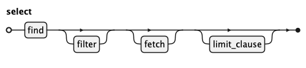

# A Guide to the Koryki Query Language

Marketing managers are creative and imaginative; they often have questions  
IT isn't prepared for, same applies to research, investigative work, and many other areas.

Today, if a marketing manager wanted to know something special, they had three choices:

- Wait for IT: Submit a ticket and wait days for a report.
- Learn SQL: Spend months learning technical syntax like INNER JOIN, GROUP BY, and HAVING.
- Ask an LLM: Let AI translate natural language to SQL.

## The cross-selling opportunity - "Gourmet Gap"

**The Goal**: Identify customers who are obsessed with Seafood but haven't yet discovered our Condiments.
Marketing Strategy: Send these customers a "Perfect Pairing" email featuring sauces and spices specifically for fish.

**Business Question**: Find customers who have ordered more than 3 Seafood items but have 0 orders for Condiments.

## The Anatomy of a Query

Let's look at the example of finding customers:

**FIND**: Tell the system which "entities" you are interested in - we are interested in customers, orders and product categories.

**FILTER**: Set your rules - our customers ordered Seafood more than 3 times, but haven't ordered Condiments.

**FETCH**: Decide what information you want to see in your final report - the company_name, context and mail are fine.

As we want a reliable system we write this down in a more formal way:

    FIND customers c, orders o, order_details od, products p, categories cat
    FILTER cat.category_name = 'Seafood' 
      AND count(od) > 3
      AND NOT EXISTS (c orders o2, order_details od2, products p2, categories cat2
          FILTER cat2.category_name = 'Condiments'
      )
    FETCH c.company_name, c.contact_name, c.mail

And for general purpose we can introduce a query-language grammar:

Read this like:

- Queries start with Keyword `FIND` 
- then we have at least one entity, we call it source here, followed by an optional list for linked entities.
- next is optional Keyword `FILTER` and a logical expression
- finally we add Keyword `FETCH` to tell the systems what to return as result.

Remember our business question:
Find customers who have ordered more than 3 Seafood items but have 0 orders for Condiments.

## Reaching into nested values

Some columns hold more than one value: a list of tags, a struct with an address, a map of attributes,
a JSON document. KQL reaches into them with a postfix selector, `@`, and works on lists with a
lambda, an expression with a named parameter and an arrow:

    FIND orders o
    FILTER o.items@1@qty > 1 AND 'gift' IN o.tags
    FETCH o.id,
          o.items@1@sku first_sku,
          list_size(o.tags) tags,
          list_transform(o.scores, x -> x * 10) tenfold

- `o.items@1@sku` is the `sku` of the first element of the list `items`; positions count from 1, and
  from the end when negative (`@-1` is the last).
- `list_transform(o.scores, x -> x * 10)` applies the lambda to every element; `list_filter` keeps
  the elements the lambda accepts, `list_reduce` folds them.
- A position or a key that is not there gives NULL, not an error.
- Where the catalog declares the members of a JSON column, `o.doc@n > 0` and `sum(o.doc@a@b@1)` work
  without a cast.
- One row per element, to group by what is inside a list ("revenue by sku"), is a generated view that
  the semantic layer treats like any other entity.

[Nested Values](NESTED.md) is the reference: which selector fits which type, the list functions, what
each database does, and the flatten views.

