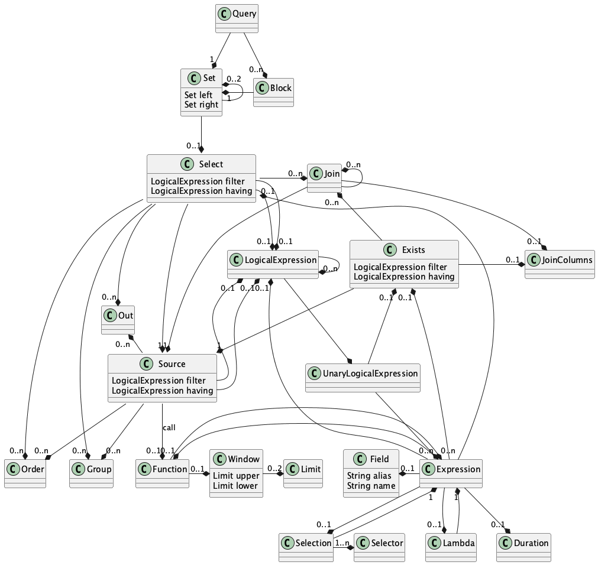

# Rules for the Intermediate Model in SQL Generation

## Overview

Each KQL query is transformed into an intermediate object model prior to SQL generation.




All transformation rules operate exclusively on this intermediate object model.
After rule processing is complete, the final SQL statement is generated from the transformed model.

---

# Transformation Rules

## 1. Push Logical Expressions to Outer-Joined Tables

**Rule:** `PushLogicalExpressionRule`

Optional linked tables may contain additional filter conditions.
In SQL, such conditions must be placed inside the `ON` clause of the `OUTER JOIN`.
If they are placed in the `WHERE` clause, the `OUTER JOIN` semantics are destroyed and effectively converted into an `INNER JOIN`.

`PushLogicalExpressionRule` moves logical expressions from the `SELECT` filter or having to the appropriate joined table.

### Example

Move the expression
`o.order_date BETWEEN "2023-01-01" AND "2023-12-31"`
to table `orders`.

```
    // give customers and optional count of orders in 2023

    FIND customers c, c+orders o
    FILTER o.order_date BETWEEN "2023-01-01" AND "2023-12-31"
    FETCH c.company_name, count(o)
```

### Expected SQL

```
    SELECT
    c.company_name
    , count(o.order_id)
    FROM
     customers c
     LEFT OUTER JOIN orders o ON
      c.customer_id = o.customer_id
     AND
      o.order_date >= DATE '2023-01-01'
     AND
      o.order_date < DATE '2024-01-01'
    GROUP BY
     c.company_name
```

### Incorrect SQL (Without Rule Application)

```
    SELECT
    c.company_name
    , count(o.order_id)
    FROM
     customers c
     LEFT OUTER JOIN orders o ON
      c.customer_id = o.customer_id
    WHERE 
      o.order_date >= DATE '2023-01-01'
     AND
      o.order_date < DATE '2024-01-01'
    GROUP BY
     c.company_name
```

This invalid transformation destroys `OUTER JOIN` behavior.
The user explicitly requested an optional count of orders; therefore, the `LEFT OUTER JOIN` semantics must be preserved.

---

## 2. Add GROUP Expressions for Non-Aggregate OUT Expressions

**Rule:** `GroupRule`

If at least one aggregate expression appears in the `OUT` clause, SQL requires all non-aggregate expressions to be included in the `GROUP BY` clause.

In the previous example, `count(o)` is detected as an aggregate expression.
Therefore, `c.company_name` is automatically added to the `GROUP BY` clause.

---

## 3. Push Aggregate Filter Expressions to HAVING Clause

**Rule:** `HavingRule`

Filter expressions that contain aggregate functions must not appear in the `WHERE` clause.
Instead, they must be placed in the `HAVING` clause.

### Example

```
    // Find customers who have placed more than 10 orders in 2023,
    // return companyname and count, sort by count.
    
    FIND customers c, c orders o
    FILTER count(o) > 10 AND o.order_date BETWEEN "2023-01-01" AND "2023-12-31"
    FETCH c.company_name, count(o) DESC
```

This query uses an `INNER JOIN`.
The expression `count(o) > 10` is an aggregate expression.

### Expected SQL

```
    SELECT
      c.company_name
    , count(o.order_id)
    FROM
     customers c
      INNER JOIN orders o ON
       c.customer_id = o.customer_id
    WHERE
      o.order_date >= DATE '2023-01-01'
     AND
      o.order_date < DATE '2024-01-01'
    GROUP BY
     c.company_name
    HAVING
     count(o.order_id) > 10
    ORDER BY
     count(o.order_id) DESC
```

Placing `count(o) > 10` inside the `WHERE` clause would result in invalid SQL.

---

## 4. Push Expressions to Tables

Expressions are classified as:

* **Homogeneous expressions** — reference at most one table.
* **Heterogeneous expressions** — reference two or more tables.

Homogeneous expressions are assigned to their referenced table.
Heterogeneous expressions remain at the `SELECT` level.

### 4.1 Push OUT Expressions

**Rule:** `PushOutRule`

Homogeneous expressions in the `OUT` clause of `SELECT` are pushed down to the referenced table.

---

### 4.2 Push GROUP Expressions

**Rule:** `PushGroupRule`

Homogeneous expressions in the `GROUP` of `SELECT` clause are pushed down to the referenced table.

---

### 4.3 Push ORDER Expressions

**Rule:** `PushOrderRule`

Homogeneous expressions in the `ORDER` clause of `SELECT` are pushed down to the referenced table.

---

## 5. Identity Rule

**Rule:** `IdentityRule`

KQL supports intuitive expressions such as:

```
count(o)
```

This differs from SQL, where a column reference (e.g., `count(o.order_id)`) or `count(*)` is required.

The `IdentityRule` transforms entity-based count expressions into valid SQL column-based count expressions.

Both table-count and column-count semantics are supported.

### What an entity resolves to, and why it depends on the question

Naming an entity means *the rows*, and that is a shorthand — it holds exactly as far as there is one
unambiguous way to resolve it. There are two questions for which there is:

| | resolves to | why |
|---|---|---|
| `count(o)` | the **first** key column | a key is never null, so counting one column counts rows. Under an outer join it is also the better choice: `count(o.order_id)` counts 0 for an unmatched row, where `COUNT(*)` would count 1 |
| `count_distinct(o)` | **every** key column | two rows differ by their whole key, not by part of it |

Everything else is refused (`IdentityUseValidator`): there is no smallest order line, so `min(od)`
is not a question with an answer.

### The composite key is what makes the distinction visible

Where a key is one column the two rows of that table coincide — the same column is both "any
non-null column" and "the whole key" — and the rule got away with resolving an entity to the first
key column always. A composite key separates them, and the second reading was missing:

```
FIND order_details od FETCH count_distinct(od) n
```

`order_details` is keyed by `(order_id, product_id)`. Resolving to `order_id` alone made this count
**orders**: 830 rows where the answer is 2155, silently, because every line of one order collapsed
into one. The same held through a query block, and for `employee_territories` (9 instead of 49).

So the rule now asks which function it stands in, and `count_distinct` expands to the full key. How
that reaches SQL is the dialect's business — see `docs/functions/aggregate.md`: a row constructor on
DuckDB, PostgreSQL and Trino, a comma list on MariaDB and Snowflake, and a refusal naming the
concatenation workaround on Oracle, SQL Server and SQLite.

**An entity never outlives this rule.** Both `ExpressionTypeResolver` and `SqlSelectRenderer` refuse
an identity outright — *"identity is not allowed here"*. Neither guesses a type or a column for it,
so a composite key cannot be half-answered somewhere downstream: either the rule resolved the entity,
or nothing did and the guard says so. Those two throws are internal invariants rather than user
errors, which is why they carry no position: what the author can get wrong is caught earlier, by
`IdentityUseValidator`, with one.

---

## 6. Infer OUT Expressions for Query Blocks

**Rule:** `InferJoinColumnsToBlockRule`

KQL abstracts join columns and does not require them to be explicitly returned.

When query blocks (CTEs) are linked to other tables, required join columns must be added automatically to the intermediate model to ensure valid SQL generation.

`InferJoinColumnsToBlockRule` performs this enrichment.

### Example

```
    // find the customer with the highest sales: the sum of unit_price * quantity of its orders,
    // order by sum and limit the result to the first row

    WITH sales AS (
    FIND orders o, o order_details d
    FETCH sum(d.unit_price * d.quantity) total DESC
    LIMIT 1
    )
    FIND customers c, c sales s
    FETCH c.company_name, s.total
```

The `sales` query block is linked to `customers`.
Therefore, the join column `o.customer_id` must be added automatically to the block.

The column has to be one the model gives the entity as an attribute: the rule adds it as a field of the
block's leading entity, and a model that leaves the foreign key out (the English northwind model has no
`employee_id` on `orders`) refuses the query with `schema.unknown-column`, at the entity the block starts
from. Return such a column in the block yourself, or give the entity the attribute.

### Expected SQL

```
    WITH sales (total, customer_id) AS (
    SELECT
      sum(d.unit_price * d.quantity) AS total
    , o.customer_id
    FROM
     orders o
      INNER JOIN order_details d ON
       o.order_id = d.order_id
    GROUP BY
      o.customer_id
    ORDER BY
      sum(d.unit_price * d.quantity) DESC
    FETCH FIRST 1 ROWS ONLY
    )
    SELECT
      c.company_name
    , s.total
    FROM
     customers c
      INNER JOIN sales s ON
       c.customer_id = s.customer_id
```

Without automatic inference of the join column, the `JOIN` condition in the outer query would be invalid.

---

## 7. Selector Names

**Rule:** `SelectorNamesRule`

A selector names a field of a struct, and a model can give the fields the words of its language:
`t.address@breitengrad` under the German model is the field `latitude` of the column. The rule runs after
the `IdentityRule` and rewrites each field name from the language of the model to the key of the column's
concept, so that the validators and the renderers speak physical keys only.

The base of the selector may be a field of a table, of a block (the rule follows it to the column the
block projects) or of a source inside an `EXISTS`. A name the model does not know stays as written, and so
does any other base, a function result or a computed output: a name the language does not translate is a
physical key, which is what a query wrote before models had member names. See
[Members and notions](MEMBERS_AND_NOTIONS.md).

---

# Summary

The intermediate model enables deterministic, rule-based SQL generation.
All transformation rules operate on the structured object representation of the KQL query to ensure:

* Preservation of join semantics
* Correct aggregate handling
* Valid SQL clause placement
* Proper grouping and ordering
* Automatic join column inference for query blocks

This layered approach ensures that generated SQL remains syntactically valid and semantically consistent with the original KQL intent.
